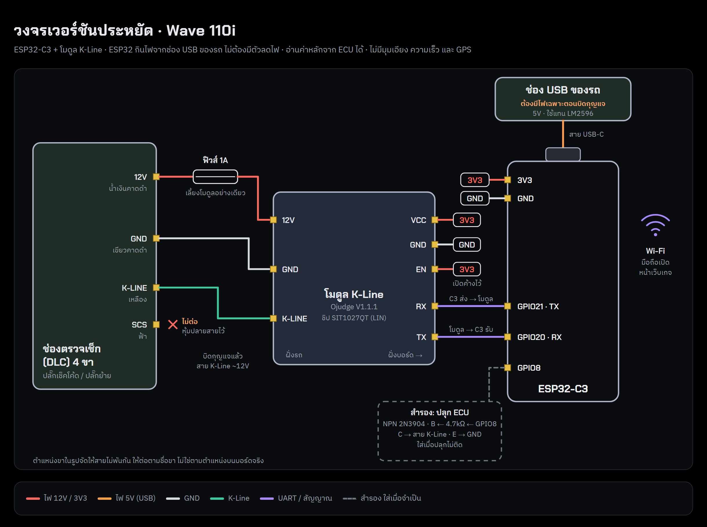

# Thunder Gauge Lite

> **Educational project.** Thunder Gauge is made for learning how a motorcycle ECU works: what each sensor reads, how the ECU reacts, and why. It is not a commercial product or a certified diagnostic tool. Use it at your own risk, and don't watch the phone while riding.
>
> โปรเจคนี้ทำขึ้นเพื่อการศึกษา: เรียนรู้ว่ากล่อง ECU ทำงานอย่างไร เซ็นเซอร์แต่ละตัววัดอะไร และ ECU ตอบสนองอย่างไร ไม่ใช่สินค้าเชิงพาณิชย์หรือเครื่องมือวินิจฉัยที่ได้รับการรับรอง ผู้ใช้รับความเสี่ยงเอง และอย่าดูมือถือขณะขับขี่

Version 0.9-beta.

A phone dashboard for the Honda Wave 110i, made for learning how the ECU works. An ESP32-C3 reads the ECU over K-Line and serves the gauge page over its own Wi-Fi. K-Line only: no GPS, no motion sensor.

The ECU side is read-only: the firmware sends only the wake/init frames and read requests (live data tables, fault-code pages). It never writes to the ECU and never clears codes.

## Files

| Path | What it is |
|---|---|
| `firmware/thunder-gauge-lite.bin` | Ready-made firmware, for updating the board from a phone |
| `firmware/thunder_gauge_lite/` | Firmware source (Arduino). `page_gz.h` is the gauge page, built by `mk_budget.py` |
| `source/smart-gauge-demo.html` | Gauge page source (opens on its own as a simulated demo) |
| `source/ecu_board.py`, `source/kline_card.*` | Turn the demo into the board page (real ECU data) |
| `source/mk_budget.py` | Builds the board page into `firmware/thunder_gauge_lite/page_gz.h` |
| `wiring-lite-usb.png` | Wiring: ESP32-C3 + K-Line module, powered from the bike's USB socket |

## Install / update from an Android phone

1. On the phone, download the firmware: [thunder-gauge-lite.bin (v0.9-beta)](https://github.com/tn-nonthawat/thunder-gauge/releases/download/v0.9-beta/thunder-gauge-lite.bin). Newer versions will be on the [Releases](https://github.com/tn-nonthawat/thunder-gauge/releases) page.
2. Turn the key on, join the Wi-Fi `ThunderGauge-Lite` (password `thunder123` until you change it). If Android says the network has no internet, choose to stay connected.
3. Open `http://192.168.4.1/update` in the browser (or System tab → อัปเดตเฟิร์มแวร์), pick the .bin and upload.
4. The board restarts by itself. If the upload breaks off, the old firmware keeps running.

The first install on a new board goes over USB: Arduino IDE → open `firmware/thunder_gauge_lite/thunder_gauge_lite.ino` → board "ESP32C3 Dev Module", USB CDC On Boot enabled → Upload. After that, updates can go over Wi-Fi as above. On first start the board opens a setup page (name, Wi-Fi name and password).

## Building it yourself

After editing the page, rebuild `page_gz.h` (Python 3, run in `source/`):

    python mk_budget.py smart-gauge-demo.html thunder-lite-demo.html ../firmware/thunder_gauge_lite

Then compile `firmware/thunder_gauge_lite/thunder_gauge_lite.ino` in the Arduino IDE (Sketch → Export Compiled Binary gives the .bin).

Wave 110i ECU: engine data is in table 0x17, O2 in 0x20, neutral switch and fuel pump in 0xD1. The ECU reports no MAP, IAT or speed.

## Which bikes work

Only one bike has been tested with this project. Not every Wave works.

| Status | Bikes |
|---|---|
| Tested on a real bike | Honda Wave 110i (2012), ECU table 0x17 |
| Likely to work (tested by other projects, not by us) | Wave 110i other years and Wave 125i with fuel injection (table 0x17); Air Blade 125 2023 (table 0x17, coolant temp in data byte 9); CBR600RR 2005 (table 0x10) |
| Experimental | Other Honda PGM-FI bikes with the red 4-pin K-Line connector (Click, PCX, Scoopy-i, MSX, Wave 125i LED...). The board tries tables 0x17, 0x67, 0x10, 0x11, 0x13, 0x60, 0x61, 0x63 and uses the first one that answers. |
| Will not work | Carburettor bikes (no ECU) and bikes with CAN bus |

How to check a bike:

1. It is fuel-injected ("i" or PGM-FI on the bike).
2. It has the red 4-pin diagnostic connector.
3. With the board connected and the key on, Settings → "เพิ่มรุ่นรถ" shows which table the ECU answered (0x17 on the Wave 110i).

If your bike is not on the list, the "เพิ่มรุ่นรถ" card can run a scan of the ECU tables (read only). Send the result as a [GitHub issue](https://github.com/tn-nonthawat/thunder-gauge/issues/new) (bike model and year, plus the scan text) so the bike can be added.

## Credits

The table layouts for other models come from facts published by these projects (no code was copied):

- [oJudgeStore/SmartGauge_for_Honda](https://github.com/oJudgeStore/SmartGauge_for_Honda)
- [andreibaw/Honda_K-Line_KWP2000](https://github.com/andreibaw/Honda_K-Line_KWP2000)
- [quangvd917/ab125-kline](https://github.com/quangvd917/ab125-kline)
